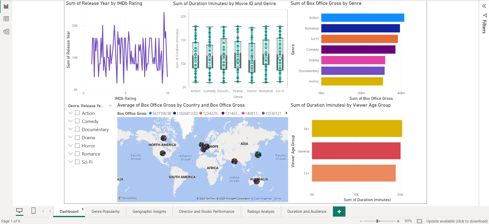
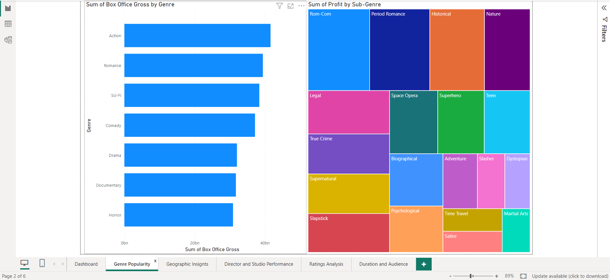
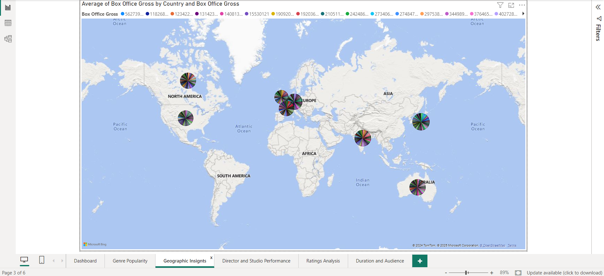
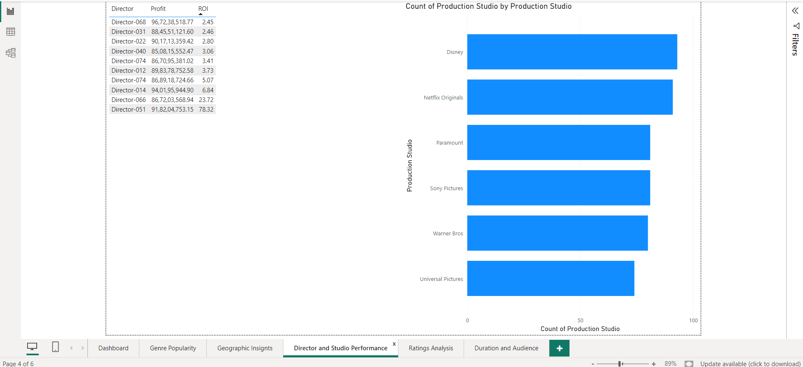
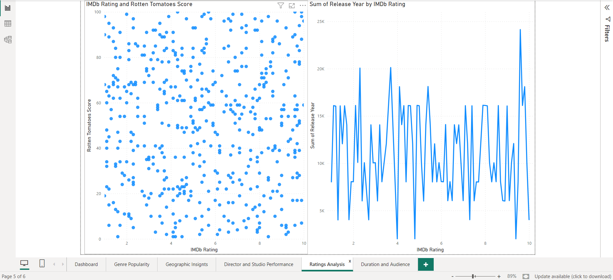
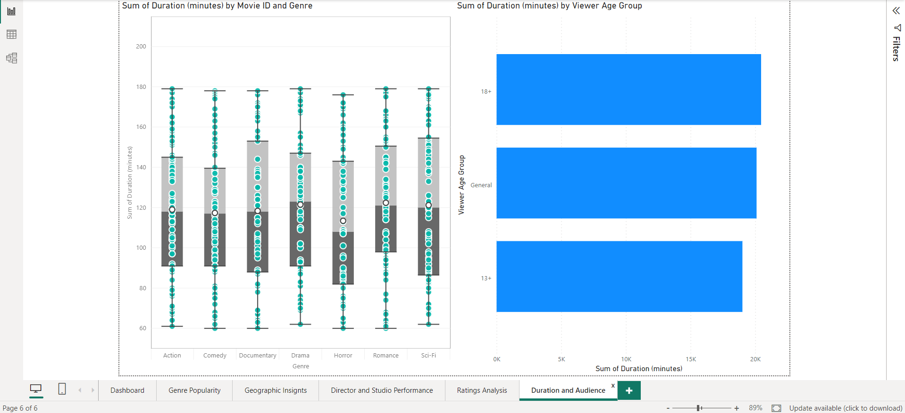
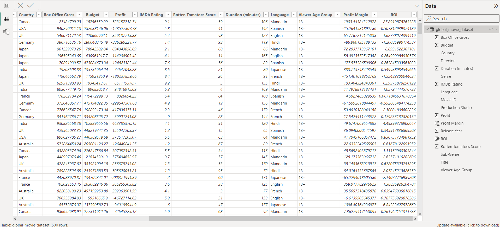

# Global Movie Dashboard

An interactive **Power BI** report exploring box-office performance, profitability, critical reception, and audience trends across 500 films from 8 countries, 6 studios, and 7 genres (2000–2023).



## Highlights

- **6 report pages**: an overview dashboard plus five focused pages
- **Interactive filtering** with a hierarchical Genre → Release Year slicer on the overview page
- **Map visual** showing box-office gross by country
- **Calculated columns** for profitability: Profit Margin and ROI
- **Mixed visuals**: bar charts, treemap, filled map with pie markers, scatter plot, line chart, box-and-whisker plot, and a ranked table

## Report pages

| # | Page | What it answers | Visuals |
|---|------|-----------------|---------|
| 1 | **Dashboard** | High-level summary of everything below | Line, box plot, bar, map, slicer |
| 2 | **Genre Popularity** | Which genres earn the most, and which sub-genres are most profitable? | Bar chart (gross by genre), treemap (profit by sub-genre) |
| 3 | **Geographic Insights** | How does box-office gross vary by country? | Map with per-country pie markers |
| 4 | **Director & Studio Performance** | Which directors deliver the best ROI? How many films does each studio produce? | Ranked table (director, profit, ROI), bar chart (films per studio) |
| 5 | **Ratings Analysis** | Do IMDb ratings and Rotten Tomatoes scores agree? | Scatter plot, line chart |
| 6 | **Duration & Audience** | How does runtime vary by genre and viewer age group? | Box-and-whisker plot, bar chart |

<details>
<summary><b>View all page screenshots</b></summary>

### Genre Popularity


### Geographic Insights


### Director & Studio Performance


### Ratings Analysis


### Duration & Audience


### Data view (with calculated columns)


</details>

## Dataset

[`data/global_movie_dataset.csv`](data/global_movie_dataset.csv): 500 rows, 16 columns, one row per film.

| Column | Type | Description |
|--------|------|-------------|
| Movie ID | Text | Unique ID (`MOV-0001` … `MOV-0500`) |
| Title | Text | Film title (anonymized) |
| Release Year | Integer | 2000–2023 |
| Genre | Text | Action, Comedy, Documentary, Drama, Horror, Romance, Sci-Fi |
| Sub-Genre | Text | 19 sub-genres (e.g. Rom-Com, Space Opera, Slasher) |
| Director | Text | 100 directors (anonymized) |
| Production Studio | Text | Disney, Netflix Originals, Paramount, Sony Pictures, Universal Pictures, Warner Bros |
| Country | Text | Australia, Canada, France, Germany, India, Japan, UK, USA |
| Box Office Gross | Currency (USD) | Total gross revenue |
| Budget | Currency (USD) | Production budget |
| Profit | Currency (USD) | Reported profit (can be negative) |
| IMDb Rating | Decimal | 1.0–10.0 |
| Rotten Tomatoes Score | Integer | 1–100 |
| Duration (minutes) | Integer | 60–179 |
| Language | Text | English, French, Hindi, Japanese, Mandarin, Spanish |
| Viewer Age Group | Text | General, 13+, 18+ |

### Calculated columns (added in Power BI)

```DAX
Profit Margin = DIVIDE ( global_movie_dataset[Profit], global_movie_dataset[Box Office Gross] ) * 100
ROI           = DIVIDE ( global_movie_dataset[Profit], global_movie_dataset[Budget] )
```

> **Note:** This is a synthetic dataset built for practicing dashboard design. Titles and directors are placeholders, and values are randomly generated (for example, `Profit` is not derived from `Box Office Gross − Budget`). Treat the visuals as a demonstration of report-building technique, not as real industry findings.

## Repository structure

```
.
├── dashboard/
│   └── Global Movie Dashboard.pbix   # Power BI report file
├── data/
│   └── global_movie_dataset.csv      # Source dataset
├── screenshots/                      # Report page screenshots
└── README.md
```

## Getting started

1. Install [Power BI Desktop](https://powerbi.microsoft.com/desktop/) (free, Windows only).
2. Clone or download this repository.
3. Open `dashboard/Global Movie Dashboard.pbix`.
4. If Power BI can't find the data source, go to **Transform data → Data source settings → Change Source** and point it to `data/global_movie_dataset.csv`, then click **Refresh**.

## Tools

- **Power BI Desktop**: data modeling, DAX, visualization
- **Power Query**: data import and type handling
- **Bing Maps** (built into Power BI): geographic visuals

## Author

**Aniket Nandi** · [GitHub @aniketnandi](https://github.com/aniketnandi)
